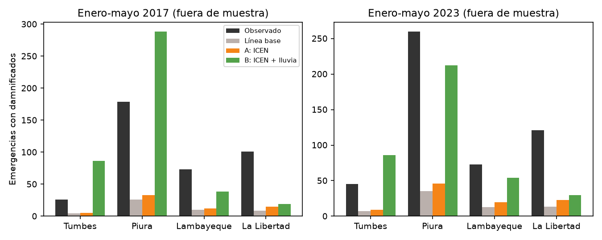
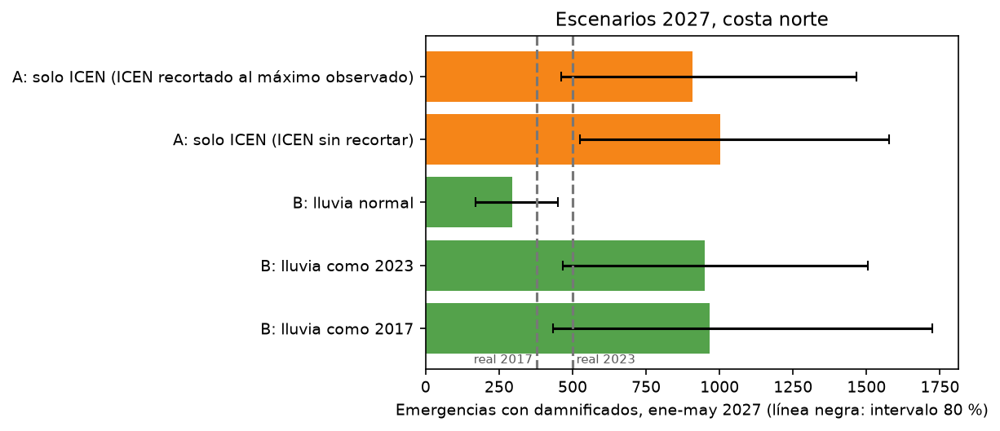
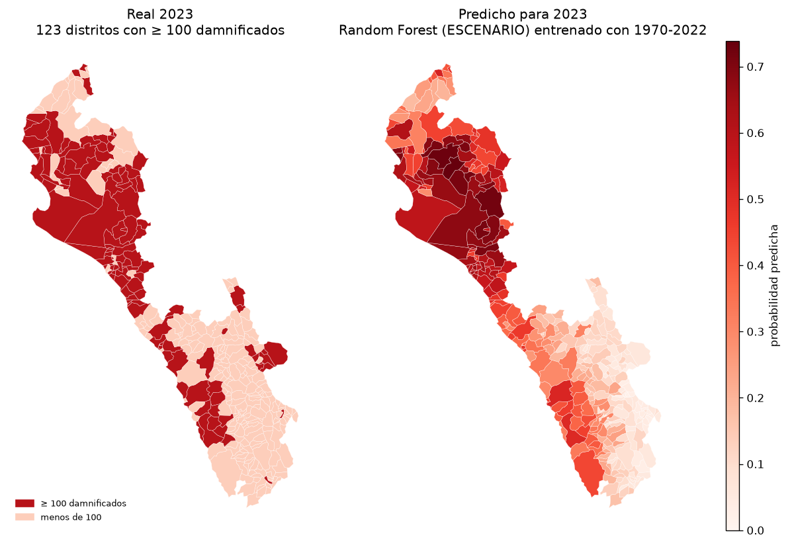
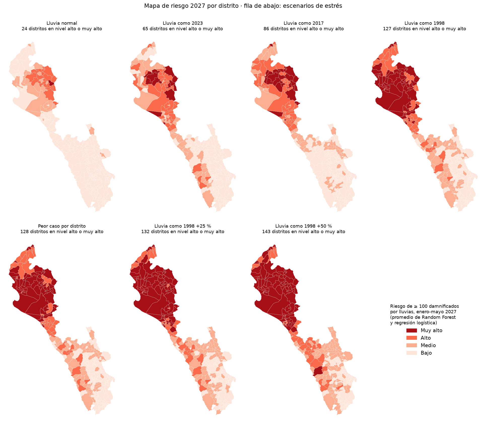
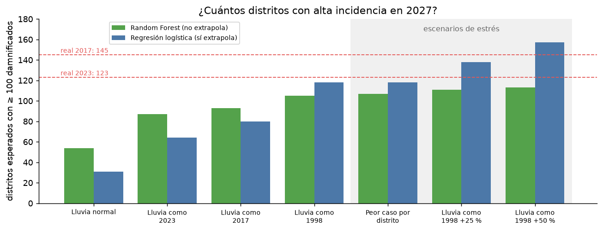

# Predicción de siniestros por El Niño Costero en la costa norte del Perú (enero-mayo 2027)

Curso: Analítica de datos y sistemas predictivos (UPC).

**Pregunta:** ¿cuántas emergencias por lluvias con damnificados (inundaciones, huaicos, lluvias intensas, deslizamientos, derrumbes y erosión) habrá en Tumbes, Piura, Lambayeque y La Libertad entre enero y mayo de 2027, ante El Niño Costero 2026-2027?

**Unidad de análisis:** departamento × mes, de 2003 a 2025 (4 × 276 = 1104 filas).

## Carpetas

```
datos/
  1_crudos/          CARPETA 1: todo lo descargado, tal cual, una subcarpeta por fuente
                     (INDECI_SINPAD, DesInventar, ENFEN_IGP_ICEN, UCSB_CHIRPS, SENAMHI_PISCO...),
                     cada una con un FUENTE.md que dice de dónde viene y cómo citarla
  2_limpios/         CARPETA 2: tablas limpias y listas para el modelo, por tema
    emergencias/     INDECI limpia, DesInventar, impactos compilados
    enso/            ICEN e índices oceánicos desde 1854
    lluvia/          por departamento, distrito y estación
    caudales/        GloFAS y caudales medidos del río Piura
    territorio/      atributos y mapa de los 364 distritos
    modelo/          panel_costa_norte_2003_2025.csv (lo que usa 03_modelo.py) y
                     panel_distrito_temporada_1970_2025.csv (distrito × temporada, para el mapa de riesgo)
    escenarios/      supuestos editables para 2027
    _calidad/        reporte_calidad.md
  CATALOGO_DATOS.md  diccionario de todas las tablas, reglas de limpieza y advertencias
scripts/             01 y 04 descargan, 02 y 05 limpian, 07 arma la tabla por distrito,
                     06 revisa la calidad, 03 modela;
                     rutas.py tiene las rutas de todas las carpetas
notebooks/           02_supervisado_distritos.ipynb: modelos de scikit-learn por distrito (semana 2)
                     03_mapa_riesgo_2027.ipynb: mapa de riesgo 2027 por distrito, con escenarios de lluvia
investigacion/       informe de investigación y sus notas
resultados/          validación, escenarios 2027, coeficientes y figuras
```

Los archivos de `1_crudos/` no se editan a mano: cualquier corrección va en `02` o `05`, así que
`2_limpios/` se puede borrar y volver a generar.

## Cómo reproducirlo

```bash
python3 -m venv .venv
.venv/bin/pip install -r requirements.txt
.venv/bin/python scripts/01_descargar_clima.py        # ICEN, CHIRPS y mapa de departamentos
.venv/bin/python scripts/04_descargar_historicos.py   # datos históricos (~600 MB, 15-30 min)
.venv/bin/python scripts/02_preparar_panel.py         # limpia INDECI y arma la tabla del modelo
.venv/bin/python scripts/05_preparar_historicos.py    # limpia el resto (~40 s)
.venv/bin/python scripts/07_panel_distrito_temporada.py  # tabla distrito × temporada
.venv/bin/python scripts/06_validar_datos.py          # reporte de calidad
.venv/bin/python scripts/03_modelo.py                 # valida y proyecta 2027
```

Los notebooks de `notebooks/` se abren en VS Code (elige el kernel `.venv`) o en JupyterLab, si lo instalas
aparte con `.venv/bin/pip install jupyterlab`. Cada uno corre completo en menos de un minuto; el 03 usa lo mismo
que el 02, así que se pueden correr en cualquier orden.

La base de INDECI se descarga a mano (el portal bloquea las descargas automáticas) y va en `datos/1_crudos/INDECI_SINPAD/BD_2003-2025_EMERGENCIAS.csv`.

## Fuentes

| Dato | Fuente | Archivo |
|---|---|---|
| Emergencias y daños 2003-2025 (142 139 registros, SINPAD) | INDECI, [datosabiertos.gob.pe](https://www.datosabiertos.gob.pe/dataset/emergencias-y-da%C3%B1os-nivel-nacional-por-departamento), publicado el 26-08-2026 | `BD_2003-2025_EMERGENCIAS.csv` |
| Índice Costero El Niño (ICEN), mensual desde 1950 | ENFEN / IGP, [met.igp.gob.pe/datos/ICEN.txt](http://met.igp.gob.pe/datos/ICEN.txt) | `ICEN.txt` |
| Lluvia mensual por satélite, ~5 km | CHIRPS v2.0 vía [IRI Data Library](https://iridl.ldeo.columbia.edu/SOURCES/.UCSB/.CHIRPS/.v2p0/.monthly/.global/.precipitation/) | `chirps_costa_norte_1991_hoy.nc` |
| Límites de departamentos | [juaneladio/peru-geojson](https://github.com/juaneladio/peru-geojson) | `peru_departamentos.geojson` |

## Preparación de los datos

- **Fechas:** de 2003 a 2024 vienen como dd/mm/aaaa y las de 2025 como mm/dd/aa. Se leen por separado y se comprueba que coincidan con las columnas AÑO y MES en las 142 139 filas.
- **Codificación:** el archivo está en Latin-1.
- **Variable objetivo:** `emerg_con_damnificados`, el número de emergencias por lluvias que dejaron al menos un damnificado. No se usa el total de emergencias porque INDECI registra cada año más eventos menores. Por ejemplo, la costa norte tuvo 996 emergencias de enero a mayo de 2025 (más que en 2017), pero diez veces menos damnificados.
- **Lluvia:** es el promedio de los puntos de CHIRPS dentro de cada departamento. La normal es el promedio de 1991-2020 para cada mes, y la lluvia relativa se calcula como `log((lluvia + 10) / (normal + 10))`.
- **ICEN:** es un promedio móvil de 3 meses centrado, o sea que el valor de un mes ya usa el mes siguiente. Por eso el modelo usa el ICEN **del mes anterior** (`icen_lag1`), para no usar información que todavía no existiría al momento de predecir.

## Modelo

Es una **regresión binomial negativa**, que sirve para conteos con mucha dispersión: en el 63 % de los meses hubo 0 emergencias con damnificados, la media es 2,5 y la varianza es 87.

- **Modelo A (pronóstico):** departamento + mes + tendencia + ICEN del mes anterior (solo la parte positiva), con un efecto adicional de enero a abril. Se puede usar sin saber cuánto lloverá.
- **Modelo B (escenarios):** el A más la lluvia relativa del mes. Responde preguntas como "¿y si llueve como en 2017?".
- **Tendencia:** el año recoge el aumento del registro. Cada año suma alrededor de 7,6 % más emergencias con damnificados.

## Validación fuera de muestra (enero-mayo, 4 departamentos)

Se entrenó solo con los años anteriores al que se predice.

| Año | Real | Línea base (promedio histórico) | A: ICEN | B: ICEN + lluvia (intervalo 80 %) |
|---|---|---|---|---|
| 2017 | 379 | 50 (−87 %) | 66 (−83 %) | **433 (+14 %)**, 163-800 |
| 2023 | 499 | 69 (−86 %) | 98 (−80 %) | **382 (−24 %)**, 177-626 |



**Lectura:**
- **Solo el modelo B anticipa la magnitud de los dos Niños.** El ICEN por sí solo no basta: en 2017 el ICEN fue solo "moderado", pero en Piura llovió 378 % de lo normal en marzo.
- **El B falla más por departamento que en el total.** En 2017 sobreestima Piura y Tumbes y subestima La Libertad.

## Escenarios para enero-mayo 2027

El ICEN de diciembre de 2026 a abril de 2027 es un **supuesto propio** basado en el Comunicado Oficial ENFEN N.° 16-2026 (`datos/2_limpios/escenarios/icen_2027_supuesto.csv`): 3,5 → 3,2 → 2,6 → 2,0 → 1,4. Se puede editar para probar otros escenarios.

| Escenario | Predicción | Intervalo 80 % |
|---|---|---|
| B: lluvia normal | 295 | 170-451 |
| B: lluvia como 2023 | 950 | 466-1505 |
| B: lluvia como 2017 | 967 | 434-1725 |
| A: solo ICEN | 908 | 462-1467 |



## Limitaciones

1. **No hay ningún Niño extraordinario en los datos de entrenamiento.** El ICEN más alto entre 2003 y 2025 fue 2,92, y para 2027 se esperan valores sobre 3. El modelo recorta el ICEN a 2,92; sin ese recorte, el modelo A da 1001. Los últimos Niños extraordinarios (1983 y 1997-98) ocurrieron antes de que empezara la base de INDECI.
2. **El modelo A no se valida bien.** Falló por más de 80 % en 2017 y 2023, así que su proyección para 2027 se debe tomar con cautela.
3. **La tendencia se extrapola.** Suponer que el registro seguirá creciendo 7,6 % al año hasta 2027 es un supuesto.
4. **Los intervalos solo incluyen el azar de los conteos.** No incluyen la incertidumbre de los coeficientes, así que en la realidad son más anchos.
5. **La base registra emergencias, no siniestros de seguros.** La ubicación es la jurisdicción que registró la emergencia, que no siempre es el lugar exacto.
6. **La lluvia es satelital.** CHIRPS puede subestimar los aguaceros extremos en la costa. Se puede comparar con las estaciones de SENAMHI.

## Datos históricos complementarios (agregados el 10-nov-2026)

Para atacar la limitación 1 (no hay Niños extraordinarios en el entrenamiento) se agregó
una segunda capa de datos. `04_descargar_historicos.py` la baja a `datos/1_crudos/` y
`05_preparar_historicos.py` la limpia en `datos/2_limpios/`. El detalle de cada tabla, sus
columnas y sus advertencias está en [`datos/CATALOGO_DATOS.md`](datos/CATALOGO_DATOS.md).

| Dato | Periodo | Para qué |
|---|---|---|
| DesInventar: desastres por distrito | 1970-2015 | Variable objetivo con 1972-73, 1982-83 y 1997-98 |
| ICEN reconstruido desde ERSSTv5 (r = 0,97 con el oficial) y ONI, RONI, SOI, MEI | 1854-2026 | Predictores oceánicos largos |
| Lluvia GPCC, PISCO (mensual y diaria) y CHIRPS diaria en eventos | 1891-2026 | Lluvia con estaciones e intensidad diaria |
| Estaciones GHCN (aeropuertos de Tumbes, Talara, Piura, Chiclayo, Trujillo...) | 1973-2025 | Validar la lluvia satelital |
| Caudales GloFAS (ene-abr) y pronóstico a 210 días | 1997-2026 | Caudal como variable intermedia |
| Atributos por distrito: pobreza, IDH, población, relieve, ríos e historial | — | Modelo a nivel distrito |
| `scripts/gee_inundaciones_sentinel1.js` | 2017, 2023 | Mapear la inundación real con radar en Google Earth Engine |

**Hallazgo importante:** en marzo de 2017 el aeropuerto de Piura midió 567,5 mm de lluvia,
pero CHIRPS da ~20 mm en esa celda. La lluvia relativa del modelo B probablemente
subestima los Niños en la costa de Piura. Ver la advertencia 1 del catálogo.

## Orden y limpieza de los datos (10-nov-2026)

Los datos se reordenaron en `datos/1_crudos/` (por fuente) y `datos/2_limpios/` (por tema).
Las reglas de limpieza están en la sección "Reglas de limpieza" de
[`datos/CATALOGO_DATOS.md`](datos/CATALOGO_DATOS.md), y el estado de cada tabla en
[`datos/2_limpios/_calidad/reporte_calidad.md`](datos/2_limpios/_calidad/reporte_calidad.md).

- **El modelo no cambió.** La tabla `panel_costa_norte_2003_2025.csv` es idéntica a la anterior, valor por valor, y `03_modelo.py` da exactamente los mismos resultados.
- **Se corrigió un error en las fechas de CHIRPS diario.** Las tablas de lluvia diaria por evento tenían las fechas mal (salían en el año 8654) porque ese archivo usa días julianos.
- **El ICEN oficial ya marca 4,50 en setiembre de 2026.** El supuesto de `escenarios/icen_2027_supuesto.csv` empieza en 3,5 en diciembre, así que conviene revisarlo al pasar a modelar.
- **Nueva tabla para modelar por distrito.** `datos/2_limpios/modelo/panel_distrito_temporada_1970_2025.csv` tiene 364 distritos × 56 temporadas (enero-mayo de 1970 a 2025), con la variable objetivo `tuvo_damnificados` y las variables separadas según si se conocen antes o durante la temporada. Antes de usarla, lee la advertencia 11 del catálogo.

## Semana 2: ¿qué distritos tendrán alta incidencia? (scikit-learn)

El notebook [`notebooks/02_supervisado_distritos.ipynb`](notebooks/02_supervisado_distritos.ipynb) usa la tabla
distrito × temporada para clasificar cada distrito en cada temporada de enero a mayo.

- **Variable objetivo:** `alta_incidencia`, que vale 1 si el distrito tuvo 100 damnificados o más en la temporada.
  También se prueba `tuvo_damnificados`.
- **Modelos:** regresión logística, Random Forest y Gradient Boosting, comparados con una línea base que solo mira
  el historial del distrito.
- **Validación:** cada año de prueba (1998, 2017 y 2023) se predice entrenando solo con los años anteriores.

ROC-AUC de `alta_incidencia` (0,5 = azar):

| Modelo | Variables | 1998 | 2017 | 2023 |
|---|---|---:|---:|---:|
| Línea base: historial | — | 0,649 | 0,666 | 0,693 |
| Random Forest | ANTES (lo que se sabe en noviembre) | 0,697 | 0,632 | 0,817 |
| Random Forest | ESCENARIO (+ ICEN y lluvia de la temporada) | 0,689 | 0,770 | 0,865 |

- **Con la lluvia de la temporada, el modelo ubica bien las zonas de alta incidencia.** En 2023, 44 de sus 50
  distritos de mayor riesgo superaron los 100 damnificados.
- **Con solo lo que se sabe en noviembre, mejora poco.** En noviembre de 2016 y de 2022 el ICEN no anunciaba los
  Niños costeros que vinieron después. Por eso el mapa de 2027 se presentará como escenarios de lluvia.
- **Las probabilidades sirven para ordenar distritos, no como porcentaje exacto.** Su nivel no está calibrado.

Los resultados están en `resultados/semana2_validacion_distritos.csv`.



## Mapa de riesgo 2027 por distrito

El notebook [`notebooks/03_mapa_riesgo_2027.ipynb`](notebooks/03_mapa_riesgo_2027.ipynb) estima, para cada distrito,
la probabilidad de tener 100 damnificados o más por lluvias en enero-mayo de 2027.

**El problema de fondo:** el ICEN de setiembre de 2026 (4,50) es el más alto de toda la serie, y un modelo que aprende
del pasado no sabe qué pasa con algo más grande que lo que vio. Por eso el notebook:

1. **Separa clima e impacto.** No predice cuánto lloverá: toma la lluvia como escenario y estima el daño que causaría.
2. **Agrega escenarios de estrés:** el peor caso por distrito (la mayor lluvia entre 1983, 1998, 2017 y 2023) y la
   lluvia de 1998 aumentada en 25 % y 50 %.
3. **Usa dos modelos:** el Random Forest del notebook 02, que ordena mejor pero no extrapola, y una regresión logística
   entrenada solo con INDECI (2003-2025), que sí sigue subiendo con más lluvia. El mapa usa el promedio de los dos.

| Escenario de lluvia | Random Forest | Regresión logística | Promedio | Distritos en nivel alto o muy alto |
|---|---:|---:|---:|---:|
| Normal | 54 | 31 | 43 | 24 |
| Como 2023 | 87 | 64 | 75 | 65 |
| Como 2017 | 93 | 80 | 87 | 86 |
| Como 1998 | 105 | 118 | 111 | 127 |
| Peor caso por distrito | 107 | 118 | 112 | 128 |
| Como 1998 +25 % | 111 | 138 | 125 | 132 |
| Como 1998 +50 % | 113 | 157 | 135 | 143 |

Las tres primeras columnas son los distritos esperados con 100 damnificados o más. Para comparar: en 2017 hubo 145
y en 2023, 123.

- **Hay 60 distritos prioritarios,** en nivel alto o muy alto con lluvia como en 2023, 2017 y 1998: 37 en Piura,
  19 en Lambayeque, 2 en Tumbes y 2 en La Libertad. Encabezan Chulucanas, Castilla, Morropón, Tambo Grande y Sullana.
- **Con 50 % más lluvia que en 1998 se suman 16 distritos,** casi todos más al sur: 11 en La Libertad y 4 en Áncash.
- **Los números son probablemente un piso.** Al validar, los dos modelos se quedaron cortos en 2017 y 2023. Además,
  en esos años llovió menos que en 1998 y aun así hubo 123 a 145 distritos con alta incidencia.
- **1998 no se pudo corregir.** DesInventar registró damnificados en solo 9 distritos de Piura (INDECI, 59 en 2017),
  así que multiplicar sus cifras no cambia nada. Por eso la regresión logística aprende solo de INDECI.
- **No es una alerta oficial.** Las alertas oficiales son las de ENFEN, SENAMHI e INDECI.

Los resultados están en `resultados/riesgo_2027_distritos.csv` (una fila por distrito y escenario, con la probabilidad de
cada modelo) y en `resultados/mapa_riesgo_2027.geojson`, que se abre en QGIS, geojson.io o Google Earth Engine.




